# 面向大规模数据的多范式并行排序系统

## 从等宽桶排序到负载均衡的并行正则采样排序

作者：TODO(学号、姓名)　课程：并行程序设计　提交日期：TODO(提交时填写)

## 摘要

大规模排序需要同时利用多核计算能力并控制数据重分布开销。本文围绕“数据分布如何影响并行负载”设计 ParaSort 系统，从等宽并行桶排序出发，通过正则采样选择分割点，并使用键值、块编号和块内位置构成的复合键拆分重复值。系统实现 Pthreads、OpenMP、MPI、MPI 与 OpenMP 混合、双缓冲流水线以及单卡和双卡 CUDA 排序，使用确定性数据生成、顺序无关校验和与统一 CSV 保证实验可复现。快速实验已在双路 EPYC 与双 RTX 4090 D 平台执行，完成 CPU、消息传递和 GPU 功能验证；其统计表和图形均由原始 CSV 生成。快速实验用于验证系统链路，正式十亿元素实验的最佳加速比、均衡改善幅度和 GPU 性能结论保留 TODO(待服务器实测)，避免从小规模结果外推。

关键词：并行排序；PSRS；负载均衡；NUMA；MPI；CUDA

## 1 背景与总体介绍

### 1.1 排序需求与并行化动机

数据库 ORDER BY、排序归并连接、搜索索引构建以及 MapReduce 的 Shuffle 都需要排序。比较排序的串行计算量为 O(n log n)，当元素数达到 10⁹ 时，即使数据可以容纳于内存，计算与数据搬移也可能成为端到端处理的瓶颈。本项目处理 uint32 键：2³⁰ 个元素占 4 GiB，输入和输出两个缓冲区至少需要 8 GiB。正式规模的 std::sort 中位耗时为 TODO(待服务器实测：E2)。

并行化并不自动保证加速。若只按键值范围等宽划分，正态、幂律与热点分布可能把大部分数据交给少数处理单元。增加线程不能消除这一最长任务瓶颈，因此需要从分解和映射策略上改进。

### 1.2 本文工作

1. 建立跨编程范式共用的数据、校验、计时与结果格式。
2. 实现“带锁等宽桶 → 无锁桶 → PSRS → 重复键 tie-break”的递进方案。
3. 将采样、划分与多路归并复用于共享内存、分布式内存及双 GPU。
4. 通过 E1–E13 区分正确性、负载、通信、调度、NUMA 与 GPU 拷贝开销。

### 1.3 实测平台

| 项目 | 当前平台 |
| --- | --- |
| CPU | 2 × AMD EPYC 7542，64 物理核，128 逻辑 CPU |
| NUMA | 8 个节点，每节点 8 物理核；不应把 2 socket 直接当作 2 NUMA 节点 |
| 内存 | 约 251 GiB 可见内存 |
| GPU | 2 × NVIDIA GeForce RTX 4090 D，每卡 24564 MiB |
| GPU 拓扑 | GPU0 位于 NUMA 2，GPU1 位于 NUMA 7，卡间拓扑 SYS |
| 操作系统 | Ubuntu 22.04.5 LTS；内核及编译器完整版本见 code/results/env.txt |
| CUDA | Toolkit 12.6，nvcc V12.6.85；驱动 560.35.05；编译目标 sm_89 |
| MPI 和 Python | 项目 conda 环境中的 MPICH、Python 3.11、pandas、matplotlib |

本次所有依赖安装仅通过 conda 完成。编译记录、机器信息、实验命令与原始结果保存在 code/results/ 中。快速实验与其他验证可能同时占用机器，相关时间只用于功能与趋势检查；正式性能实验应独占机器并保持一致的绑定策略。

### 1.4 课程知识点与实现对应

| 课程内容 | 系统中的对应 |
| --- | --- |
| UMA、NUMA、加速比与效率 | first-touch、OMP_PROC_BIND、E2/E7；以 std::sort 为串行基线 |
| PCAM、输入和输出分解 | 输入连续块、本地排序、采样值域桶、任务映射 |
| BSP、全交换、负载均衡 | PSRS 四个超步；MPI_Alltoallv；imbalance |
| SAS、MP、Hybrid | Pthreads/OpenMP、MPI、MPI+OpenMP |
| 流水线 Type 2 | 逐元素保留最大值；分块有序缓冲与双缓冲通信 |
| 锁、路障、false sharing | locked/local 桶排序，pthread_barrier，64 字节对齐计数 |
| OpenMP schedule、task | 过分解归并、static/dynamic/guided、task 快排 |
| 工作窃取与库算法 | task 递归分解；GNU parallel sort 作为参考 |
| MPI 集合与非阻塞通信 | Gather(v)/Bcast、Allgather(v)、Alltoall(v)、Isend/Irecv、Sendrecv |
| MapReduce Partitioner、Shuffle | 采样分割点、数据全交换、桶内归并 |
| GPU SIMT、层次化原子、流 | 共享哈希直方图、bitonic、cudaEvent、pinned memory、多卡协同 |

## 2 问题分析与并行算法设计

### 2.1 分解

对 n 个元素和 p 个处理单元，块 i 的区间为 [⌊in/p⌋,⌊(i+1)n/p⌋)。用 128 位中间乘积避免大规模边界计算溢出，实际下标与长度为 64 位。输入分解允许各块独立生成和本地排序；输出分解则按分割点定义最终桶。两个分解的映射通常不同，因此需要重分布。


局部排序之间不存在依赖，分割点计算依赖全部样本，归并依赖分段边界与接收完成。关键路径由最大局部工作量、采样同步、重分布和最大输出桶决定。负载平衡的目标是缩短最大任务，而不只是降低平均任务大小。

### 2.2 通信

任意输入块都可能包含属于任意输出桶的键。共享内存实现用前缀和计算输出位置，分段直接读源数组；MPI 实现先 Alltoall 交换计数，再 Alltoallv 交换连续有序片段。总键数据搬移量为 O(n)，但大规模进程间潜在消息数为 O(p²)。当每条消息太小，延迟和同步会压过有效载荷。

### 2.3 组合与粒度

按元素加锁实现简单，却使每个 push_back 都进入临界区；MPI 逐元素发送也会产生大量消息。无锁桶排序把工作组合为“计数—前缀和—连续写入”，PSRS 把通信组合为已排序连续片段，分块流水线则按批传输。粒度增大可以减少调度和通信开销，但过大的桶又限制可利用并行度，因此需要实验寻找平衡。

### 2.4 映射与偏斜

对于标准差 σ 的正态分布，中心桶宽 w 内的概率为 Φ(w/(2σ))−Φ(−w/(2σ))。若各桶按整体最小最大值等宽划分，中心概率可远高于理想的 1/p；具体比例还依赖样本极值，不宜固定为无条件常数。V1 每桶映射到一个线程，因此总时间至少是最大桶串行排序的时间。

PSRS 用样本分位数代替等宽值域；重复值再用复合键拆分。过分解形成 B=kp 个输出任务，通过动态调度减少剩余任务大小差异。其代价是更多分割点、边界元数据与小归并任务。

### 2.5 BSP 计算模型

PSRS 的四个超步为本地排序、采样与分割点、划分与交换、多路归并。设 m≈n/p、g 为每元素通信代价、L 为同步延迟，则近似为：

T(p) ≈ O(m log m) + O(kp² log(kp²)) + O(gm) + O(m log p) + O(pL)。

该式说明 root 采样排序和集合通信开销会随 p 增长。共享内存版本虽没有网络发送，仍需访问源块所在内存，跨 NUMA 的远程读取也不是零代价。

## 3 系统总体设计与模块构成

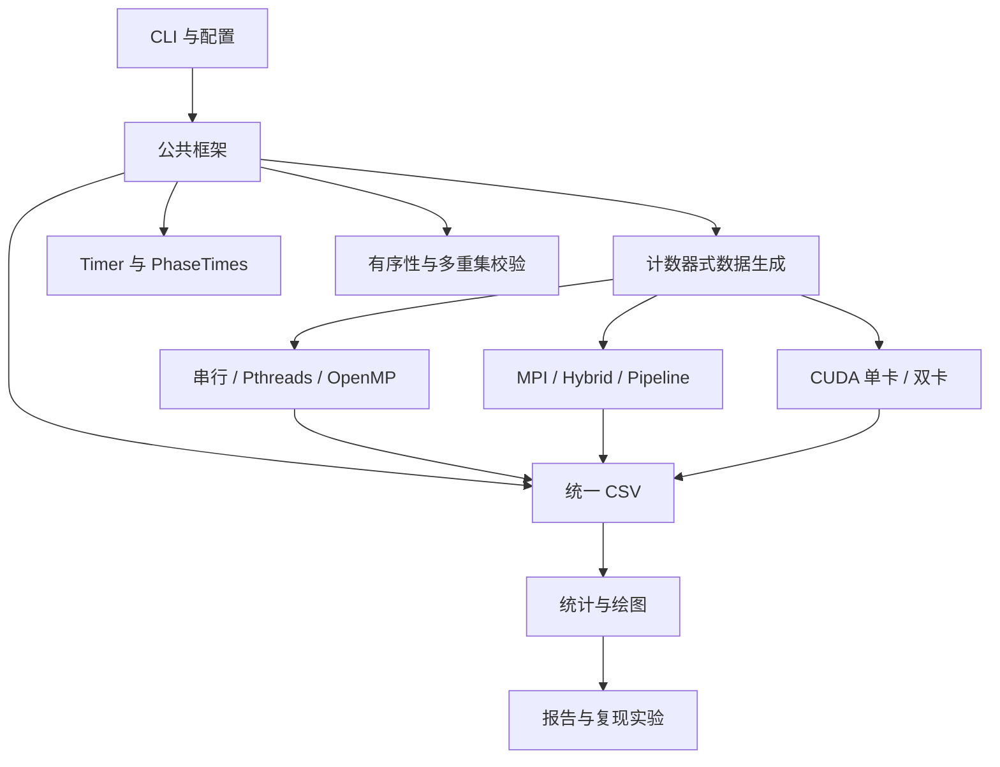

| 模块 | 职责 |
| --- | --- |
| common | CLI、计数器数据生成、计时、指纹校验、CSV、公共采样与归并 |
| seq | std::sort 与 1024 桶串行等宽排序 |
| pthreads/openmp | 带锁与无锁桶、PSRS、库参考、任务快排 |
| mpi | 分布式 PSRS、混合排序、线性流水线 |
| cuda | Thrust、样本排序、层次化原子、单桶 bitonic、双卡交换 |
| tests/scripts/analysis | 边界回归、E1–E13、环境记录、中位数表和图表 |

生成函数的第 g 项只依赖 seed、全局下标 g、分布和总规模 n。连续分布由 SplitMix64 产生，正态用 Box–Muller，幂律用 u⁸，热点和少量唯一键制造重复值。MPI 各 rank 无需从 root 获取全量输入；按块生成与整体生成逐元素一致。

排序前后检查元素个数、Σmix64(x) mod 2⁶⁴ 和 XOR mix64(x)。这两个指纹是高概率错误检测而非数学上的无碰撞证明，所以小规模还与 std::sort 逐元素比对。校验和生成均在排序计时之外。CSV 每行对应一次正式重复，热身不输出。CPU 总时间用 steady_clock，MPI 用 Barrier+Wtime 并取 rank 最大值，GPU 阶段用 cudaEvent。

## 4 主要算法与实现思路

### 4.1 Pthreads 等宽桶排序

带锁版对每桶维护 mutex；每个线程扫描输入时锁定目标桶再插入。无锁版先计算 cnt[t][b]，线程 0 前缀和得出每个线程的独占写区间，然后并行散射并由桶所属线程排序。

```text
并行求块 min/max，归约全局值域
并行计数 cnt[t][bucket(key)]
路障；计算全局桶起点及线程专属偏移
并行写入 out[offset[t][bucket]++]
路障；线程 b 排序桶 b
```

计数表行按 64 字节对齐，减少不同线程写同一缓存行。线程每次排序只创建和回收一组，各阶段用同一组线程完成。线程创建失败通过启动门控使已创建线程退出，避免它们进入永远凑不齐参与者的路障。复杂度为 O(n/p + p² + max_b(n_b log n_b))，最坏负载仍可能集中于单桶。

### 4.2 OpenMP PSRS

本地排序后，每块取最多 kB 个等间距样本，索引为 ⌊sm_i/min(kB,m_i)⌋。样本按复合键排序，在 ⌊jS/B⌋ 选择分割点；各块二分找到边界。桶 j 是 p 个有序段的并集，使用小顶堆归并。

```text
parallel: sort(block[i])
parallel: samples[i] = regular_sample(block[i])
splitters = quantiles(sort(all_samples))
parallel: bounds[i] = upper_bounds(block[i], splitters)
dst = prefix_sum(bucket_sizes(bounds))
parallel for bucket j with chosen schedule:
    merge(all_source_segments[j], out + dst[j])
```

正确性不变量为：分割点非递减；每个元素唯一归入一个分割点区间；桶内归并正确。因此采样不足影响均衡而不影响排序。复合键 `(key, block, pos)` 使相同值也可跨桶划分，输出仅存原始键。源块号更小时等键全在左侧，更大时全在右侧，同块按 pos 包含分割点切开。

经典 2n/p 负载界依赖等长块和足够采样等假设。有限规模、不等长块与 n<p 时应保留取整修正，不能将所有归一化结果都断言 ≤2。均匀输入也没有无条件的 1.1 上界；采样参数需要实测。时间近似 O(m log m + kB·p log(kB·p) + n log p/p)，空间为 2n 个键和 O(pB) 元数据。

### 4.3 MPI PSRS

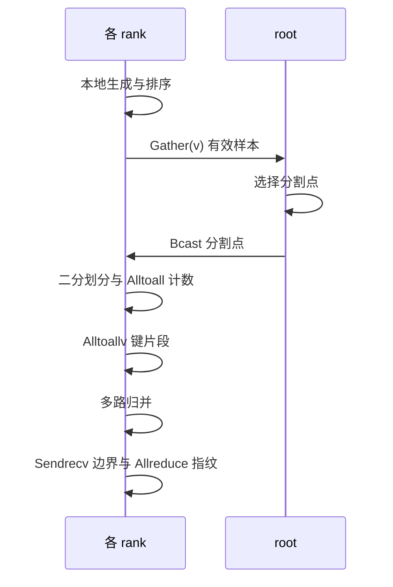

样本用 3×uint64 派生类型表达。空块不贡献样本，短块只发送有效样本，因此采用 Gatherv，避免 UINT32_MAX 填充值与真实最大键混淆。Allgather 变体让所有 rank 自行选择分割点，减少 Bcast 的同时重复样本排序工作。

跨 rank 校验跳过空 rank：先获取各桶大小，再把本地最大值传给最近的右侧非空 rank，与其最小值比较。所有 rank 必须参与指纹归约，即使本地有序性失败也不能跳过集合操作。接收数量与 int 位移均先检查再调用 MPI；发生不可恢复错误时 MPI_Abort 避免其他 rank 挂起。

### 4.4 MPI 与 OpenMP 混合

MPI 初始化请求 MPI_THREAD_FUNNELED，全部 MPI 调用发生在主线程。rank 内本地排序复用共享内存 PSRS；交换结束后对收到的 p 个有序段再采样，用值域边界切成 T 个输出区域，T 个线程独立归并，避免归并阶段退回单线程。

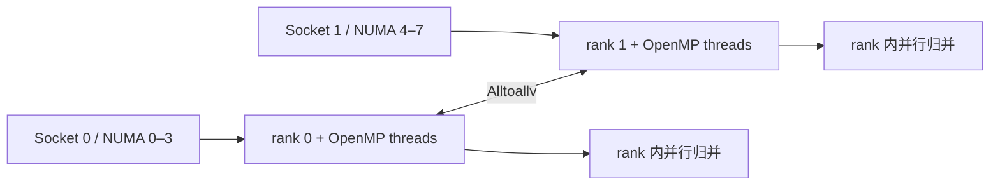

该图是每 socket 一 rank 的配置示意；本机还应测试每 NUMA 节点一 rank。混合模式减少 MPI 参与者与样本规模，但 rank 内同步、NUMA 访问和额外采样都可能抵消收益，不能预先断言必然更快。

### 4.5 流水线排序

逐元素版令 n=p、批大小为 1、每阶段容量为 1，每个阶段保留当前最大值，把较小值向右传递。分块版容量按倒序输入分块大小分配，因此容量之和恰好为 n，也覆盖 n 不能整除 p 和 n<p 的情况。

```text
每阶段初始化有序缓冲 held 和两组收发槽
依次接收下一批并排序
merged = merge(held, batch)
保留最大的 capacity 个元素
把较小的 spill 用 Isend 发向右邻居
输入结束后等待发送完成，再传递结束标记
按逆 rank 顺序 Gatherv 得到升序结果
```

接收数据在处理完成后才能重新向同一槽发布 Irecv；发送缓冲在 MPI_Wait 前保持不变。两个槽交替使用，使下一批接收与当前批计算重叠，零长度有序消息表示结束。

| 时间步 | P0 | P1 | P2 |
| --- | --- | --- | --- |
| 0 | 处理批 A | 空闲 | 空闲 |
| 1 | 处理批 B | 处理 A 的溢出 | 空闲 |
| 2 | 处理批 C | 处理 B 的溢出 | 处理 A 的溢出 |
| 3 | 处理批 D | 处理 C 的溢出 | 处理 B 的溢出 |

总时间包含填充与排空，约为 (p−1)t_stage + 批数·t_max_stage，另外还有最终收集。元素最坏穿过 p 个阶段，每阶段还要维护和归并缓冲，因此不能把它当作 PSRS 的高性能替代；E10 用于说明并行模式的适用边界。

### 4.6 CUDA 单卡与双卡

单卡基线直接调用 Thrust sort。样本版从设备输入等距抽样，选择 B−1 个分割点，经二分求桶号，计数、scan、散射后对每桶排序。B 为 ceil(n/4096) 的上取二次幂。


每个 CUDA block 为 256 线程，以 512 元素为一组做网格步进。共享哈希表有 1024 槽，最多插入 512 个不同桶，因此不会因表满而无限探测。先对共享计数做原子累加，再按活跃桶对全局计数做原子合并；散射按桶批量预留全局连续区间，加上线程在桶内的局部序号，得到唯一输出位置。naive 开关使用每元素全局原子，作为竞争对照。

单桶 bitonic 使用 8192 个键的共享空间，即 32 KiB。桶大小不超过 8192 时补齐到二次幂，以 UINT32_MAX 填充；更大桶回退 Thrust 并记录个数。设计中 12288 个元素补齐为 16384 会需要 64 KiB，不能直接套用 48 KiB 容量判断。

双卡使用两个 OpenMP 线程，各自设置设备与 stream。本地排序后，主机对两组样本选一个复合分割点；每卡保留自己的片段并接收对方片段，用 Thrust merge 完成最终桶。先检测双向 P2P，实际采用的 peer 或 pinned_host 路径写入 extra。GPU0、GPU1 属于不同 NUMA 节点，SYS 拓扑意味着交换还跨 CPU 互连，传输开销需要独立分析。

### 4.7 MapReduce 和 Spark 对应

| 本项目 | MapReduce / Spark |
| --- | --- |
| 本地生成与排序 | Map 端处理及局部有序化 |
| 样本与分割点 | TotalOrderPartitioner 的边界文件；RangePartitioner 的采样与范围边界 |
| 源块到目标桶 | Shuffle / repartition |
| 桶内多路归并 | Reduce 端归并排序 |

Hadoop 的 TotalOrderPartitioner 读取外部生成的切分点，Spark 的 RangePartitioner 根据采样估计键范围。可以从算法结构上把它们与样本排序联系起来，但二者实现、容错与数据系统开销不同，不将 JVM 或集群框架时间直接作为本系统算法性能证据。

## 5 针对性优化

| 现象 | 原因分析 | 措施 | 对应证据 |
| --- | --- | --- | --- |
| 偏斜分布的最大桶很大 | 等宽值域不等于等概率 | 正则采样分割点 | E4 的时间与 imbalance |
| 重复热点键挤入单桶 | 仅按 key 比较无法拆分等值区间 | 复合键 tie-break | E4 hotkeys/few_unique 对照 |
| 均衡后仍有任务差异 | 样本有限、桶大小取整与局部归并成本不同 | 过分解与动态调度 | E6 |
| 线程增加后插入变慢 | 高频临界区与共享 vector 竞争 | 本地计数、前缀和与无锁散射 | E8 |
| 计数器写入互相干扰 | 相邻线程共享缓存行 | 64 字节对齐行 | 与 E8 实现一起解释 |
| 跨节点访问变慢 | 串行初始化把页集中到一个 NUMA 节点 | first-touch、绑定与 rank 映射 | E7 |
| MPI rank 增长后交换变慢 | 小消息数、同步和 root 样本量增长 | 减少 rank，rank 内线程并行 | E9 |
| GPU 全局原子竞争 | 相同或附近桶大量并发更新 | 共享聚合和成批预留写位置 | E11 naive/hierarchical |
| GPU 总时间远大于设备排序 | H2D/D2H、主机同步、跨卡中转 | pinned memory、异步 stream、记录分阶段 | E11 |

这些措施都有代价。例如共享哈希表也要初始化并处理冲突，样本排序多出 scan 和散射，Thrust 基数排序可能更快。必须用实际分布、规模与时序比较判断收益，不能把“使用更多并行机制”直接当作优化结论。

## 6 测试

### 6.1 正确性

E1 快速矩阵覆盖 0/1/2/7/1000 元素、全部八种分布、CPU 的 1/3 线程，缩减 MPI 参数矩阵并加入 GPU。程序每次正式计时前另有热身，二者均校验。更大 GPU 验证与扩展 CPU/MPI 矩阵的终端记录放在 code/results/validation/；对应原始 CUDA 验证数据在 GPU_validation.csv。

具体已验证数量与状态见 [验收记录](../IMPLEMENTATION.md)。PASS 截图：TODO(用户补充终端截图)。功能回归不用于证明加速，尤其是过小数组上并行启动开销可能占主要部分。

### 6.2 强扩展与效率

S(p)=T_std_sort/T_parallel(p)，E(p)=S(p)/p；混合的 p 是 rank×threads，GPU 比较注明卡数。快速结果表见 [E2](tables/E2_quick.md)，正式结果 TODO(待服务器实测：n=2³⁰，p=1..128)。

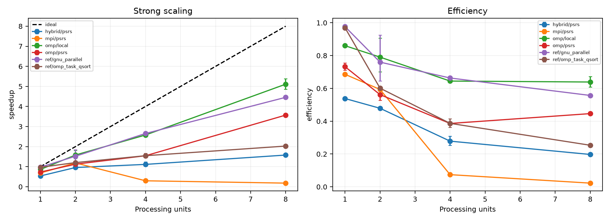

本图的输入仅为快速规模，适合检查曲线、串行基线和单位数计算。线程越多未必越快；对小数组，采样、线程同步和进程通信占比可能迅速上升。64→128 的超线程收益不能由本图推断。

### 6.3 弱扩展

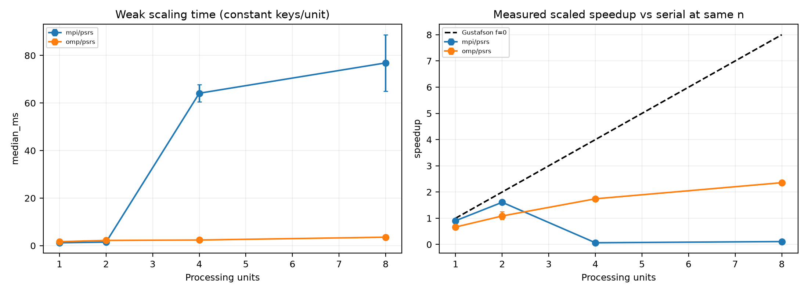

E3 保持每单元输入量不变，同时记录每个总规模的真实串行基线。由于排序自身含 log n 因子，理想弱扩展时间也不必严格恒定；应把数据规模增长和通信开销区分开。图中缩放加速比用同 n 的 std::sort，Gustafson f=0 线仅作为理想参考。

### 6.4 分布与阶段分解

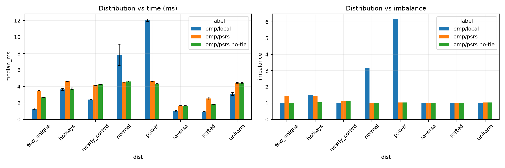

E4 同时给出时间与失衡，防止把所有差异都归因于线程框架。等宽桶、PSRS 无 tie-break、PSRS 有 tie-break 使用同一输入与线程数。应重点检查 normal/power 与 hotkeys/few_unique 两组原因不同的负载问题。快速模式只有 8 个线程，而输入有 8 个热点键，所以无 tie-break 也可能表现均衡，不能据此否定重复键问题。另以 64 线程、2²⁴ 元素做专项验证，结果见 [专项验收表](tables/M2_acceptance.md)。

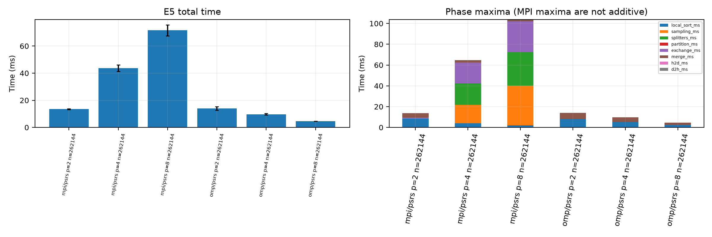

MPI 各阶段单独取 rank 最大值，这些最大值可能来自不同 rank，堆叠高度不必等于最大总时间。采样选择、交换和归并的占比有助于确定下一个优化方向，不能仅凭总时间判断通信是否主导。

### 6.5 调度、NUMA 与锁竞争

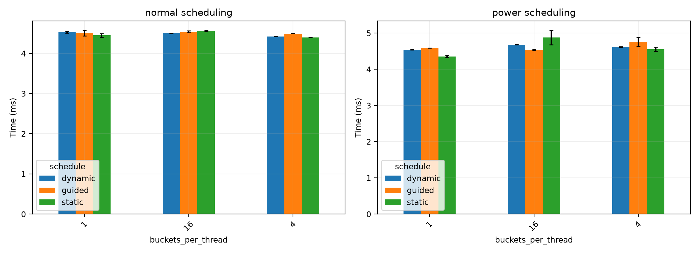

过分解增加可调度任务数，同时扩大边界矩阵。若采样已较均衡，dynamic/guided 的调度开销可能超过其收益，应按 E6 的组合参数比较而不是跨配置混算中位数。

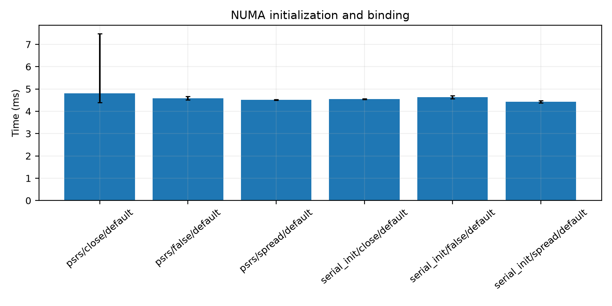

E7 比较串行和并行初始化、close/spread/false，以及系统允许时的 interleave。受限环境若禁止 set_mempolicy，会在 status.json 中明确跳过。正式实验还需要保证独占机器，并核实每个线程的实际 CPU 与页放置。

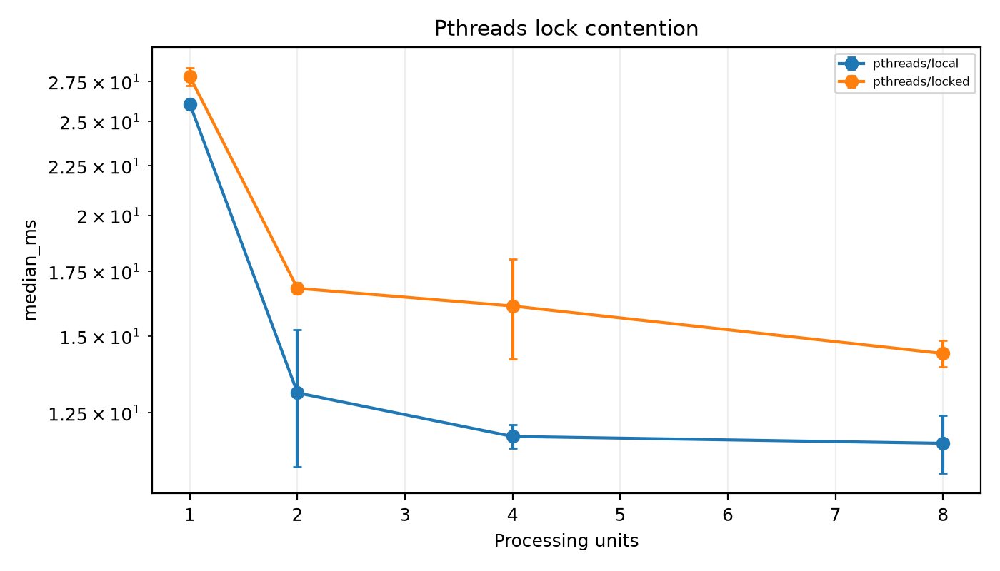

locked 与 local 使用相同桶划分，因此其差异主要来自临界区、分发和存储行为。对数轴帮助识别锁竞争导致的非线性开销，但正式结论应增加重复并结合 E5 的阶段观察。

### 6.6 MPI 通信与流水线

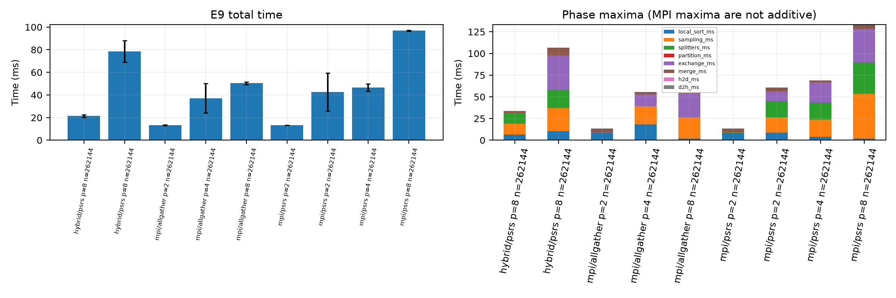

纯 MPI、Allgather 和混合模型的输出校验规则一致。Allgather 省去 Bcast 但复制采样排序工作；混合减少 rank 后又引入 rank 内 PSRS 和归并分割，收益随粒度变化。

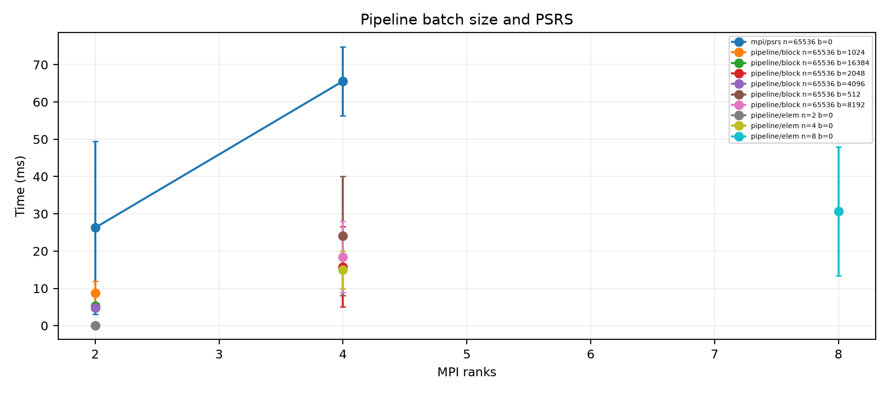

流水线测试区分 n=p 的逐元素演示和大于 p 的分块处理。小批次增加消息数，大批次增加合并工作和填充延迟，因此存在参数权衡；最终收集也包含在 pipeline 总时间内。

### 6.7 GPU 与全局比较

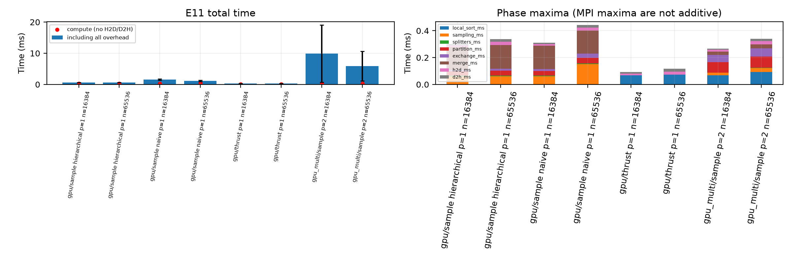

GPU 图分开标出含全部开销的总时间和排除 H2D/D2H 的计算阶段时间。快速规模主要用于验证实现，尚不足以断言双卡更快、样本排序优于 Thrust 或层次化原子在所有分布上更好；需要完整 E11 的 2²⁴..2³⁰ 实验。

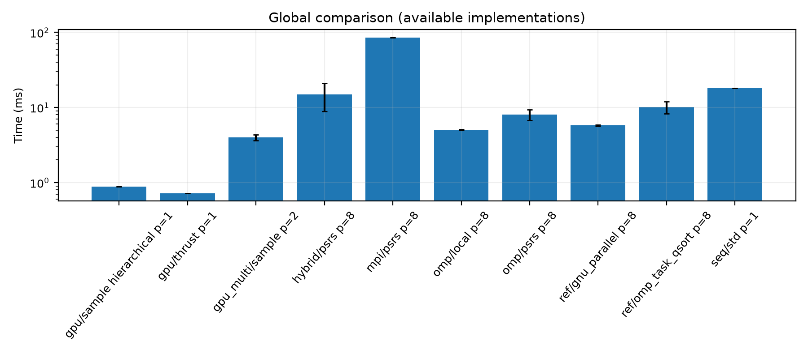

全局比较统一以主机内存就绪为起点、主机可用有序结果为终点，GPU 的 PCIe 拷贝包含在 total_ms 中。只有同规模、同分布、同种子的 seq/std 才作为加速比基线。

## 7 性能分析与定律拟合

Amdahl 模型使用 T(p)=Tseq[f+(1−f)/p]+α(p−1)。脚本在 f∈[0,1]、α≥0 的约束下拟合，并输出误差与有效测量点数；以真实串行 std::sort 为 Tseq。α(p−1) 是对增长开销的经验近似，并非所有排序范式的精确通信模型。

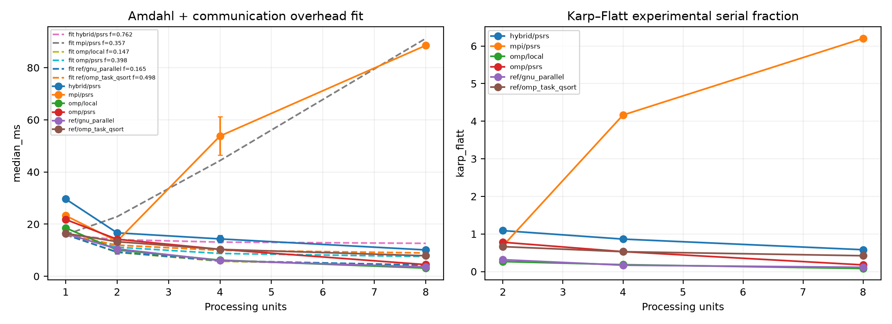

拟合参数见 [E13](tables/E13.md)。Karp–Flatt e(p)=(1/S−1/p)/(1−1/p) 仅定义于 p>1；它是课件外的补充指标。其增大可能反映同步、通信与内存带宽竞争，不能直接等同于算法固有串行比例。负值也可能来自超线性缓存收益或测量波动，应结合规模与重复区间解释。

Gustafson 理想缩放模型为 S_G(p)=p−f(p−1)。本项目弱扩展实际测量同总规模串行排序与并行排序的比值，并用理想线作参照。正式的 f、α、Karp–Flatt 变化与 64→128 超线程分析为 TODO(待服务器实测)。内存带宽上限分析还需要实际带宽工具测量，不能用硬件理论带宽代替本程序获得的有效带宽。

## 8 总结与思考

本项目采用 BSP 组织 PSRS 的本地计算、通信与同步，以连续块进行输入分解，以采样分位数进行输出分解。基础映射为静态块到线程、桶到处理单元；过分解与运行时 schedule 进一步提供动态任务映射。PSRS 属于数据并行与全交换模式，task 快排体现递归任务图，流水线属于 Pipe-and-Filter。

分解的主要挑战依次是分布偏斜、重复键、重分布通信和存储层次。正则采样直接针对等宽值域失衡，复合键针对热点重复值，混合模型针对过多 MPI 参与者，共享聚合针对 GPU 原子竞争。每个优化都需要相匹配的实验来证明；快速测试已经验证系统与实验链路，正式性能结论仍待完整规模实验。

当前限制包括：全部数据需放入内存；MPI legacy count 限制单 rank 数据量；PSRS 使用堆归并而非败者树；GPU 大桶会回退库排序；没有多节点网络实验和持久化外部排序。未来可研究外部归并、多节点通信拓扑、GPU 分段基数排序与动态切分超大桶。TBB 和 PySpark 是设计中的可选项，本项目未把它们列为必须依赖。

## 参考文献

1. 课程并行程序设计讲义。章节与页码依据给定 DESIGN.md；TODO(用户补充课件原件及教师信息)。
2. H. Shi, J. Schaeffer. Parallel Sorting by Regular Sampling. Journal of Parallel and Distributed Computing, 1992。经典 PSRS；TODO(提交前对照课程要求补全书目信息)。
3. Xiaobo Li, Paul Lu, Jonathan Schaeffer, John Shillington, Pok Sze Wong, Hanmao Shi. [On the Versatility of Parallel Sorting by Regular Sampling](https://doi.org/10.1016/0167-8191(93)90019-H). Parallel Computing, 19(10), 1079–1103, 1993。
4. L. G. Valiant. A Bridging Model for Parallel Computation, 1990。BSP 模型。
5. J. Dean, S. Ghemawat. [MapReduce: Simplified Data Processing on Large Clusters](https://research.google/pubs/mapreduce-simplified-data-processing-on-large-clusters/). OSDI 2004, 137–150。
6. A. H. Karp, H. P. Flatt. [Measuring Parallel Processor Performance](https://www.cse.iitd.ac.in/~rijurekha/col380_2024/class3_0_karp_flatt_orig.pdf). Communications of the ACM, 33(5), 539–543, 1990。
7. [MPI Forum, MPI 4.1 All-to-All Scatter/Gather](https://www.mpi-forum.org/docs/mpi-4.1/mpi41-report/node128.htm)。
8. [NVIDIA CUDA Programming Guide](https://docs.nvidia.com/cuda/cuda-programming-guide/index.html)。
9. [Apache Hadoop TotalOrderPartitioner](https://hadoop.apache.org/docs/stable/api/org/apache/hadoop/mapreduce/lib/partition/TotalOrderPartitioner.html)。
10. [Apache Spark RangePartitioner](https://spark.apache.org/docs/latest/api/scala/org/apache/spark/RangePartitioner.html)。
11. [OpenMP Specifications](https://www.openmp.org/specifications/)。

## 附录 复现与待完成项

构建、命令行、OpenMPI 与 MPICH 区别、NUMA 映射和提交方法见 [代码 README](../code/README.md)。原始表格和图片由 `analysis/summarize.py`、`analysis/plot.py` 从 `code/results/*.csv` 自动生成。

TODO(待服务器实测)：独占机器执行完整 `scripts/run_all.sh`，解释实际结果、更新摘要中的正式性能数字、解释 min/max 误差区间并补上 128 处理单元分析。TODO(用户补充)：编译和 PASS 终端截图、htop、双卡负载及环境截图；学号姓名；教师模板的 docx/pdf 排版。最终提交只包含代码与报告，不包含 conda 环境和编译缓存。
